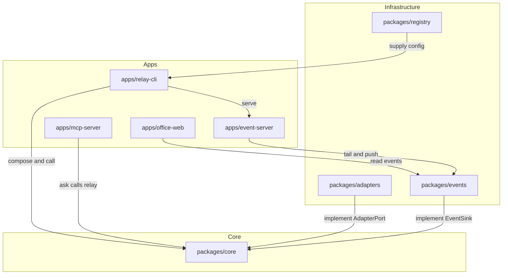

Chinese: [README.md](./README.md)

# grokbot-ai-office

grokbot-ai-office is a multi-AI collaborative office: any AI joins Grok Bot group chats the same way, and a live virtual-office UI shows what each AI is doing.

The project has two layers:

1. The relay layer is the foundation. `ai-relay`, the registry, adapters, and events connect any AI to the group chat and record what it is doing.
2. The virtual-office UI is the front. It reads those events and shows each AI.

Goals:

1. Add a new AI by editing configuration first, not core code.
2. Report failures with an error code. Never invent an answer.
3. Keep secrets out of the repository.
4. Keep the UI decoupled from relay logic.

## Three auth methods

| `auth` | Adapter | Where credentials live | Used for |
| --- | --- | --- | --- |
| `subscription` | CLI adapter | The CLI's own login files. The repo never stores them. | Codex, CodeBuddy, Hermes, OpenClaw |
| `api_key` | Official API adapter | Environment variables. Config only names `key_env`. | DeepSeek, Anthropic (Claude), Gemini, Kimi, GLM, MiniMax, OpenRouter |
| `openai_compatible` | OpenAI-format adapter | `base_url` plus optional `key_env` | Proxies, OpenRouter, local Ollama |

Implemented official vendors are DeepSeek, Kimi, GLM, Anthropic (Claude), and Gemini. Claude reads `ANTHROPIC_API_KEY`. Gemini reads `GEMINI_API_KEY`. Their examples are commented out in `configs/providers.yaml` and stay disabled until you uncomment them.

## Architecture



Apps wire dependencies. `packages/core` defines `AdapterPort` and `EventSink` and does not call a CLI or HTTP API itself. `apps/office-web` only reads `packages/events`.

## Layout

```
grokbot-ai-office/
├── AGENTS.md
├── README.md
├── README.en.md
├── CONTRIBUTING.md
├── CHANGELOG.md
├── .github/workflows/ci.yml
├── .gitignore
├── .env.example
├── package.json
├── pnpm-workspace.yaml
├── turbo.json
├── tsconfig.base.json
├── biome.json
├── .releaserc.json
├── packages/
│   ├── core/
│   ├── adapters/
│   ├── registry/
│   └── events/
├── apps/
│   ├── relay-cli/
│   ├── event-server/
│   ├── mcp-server/
│   └── office-web/
├── configs/providers.yaml
├── scripts/
├── docs/
└── tests/
```

## Quick start

Requires Node.js 22 and pnpm 9.

1. Install dependencies: `pnpm install`
2. Build: `pnpm build`
3. Check: `pnpm lint && pnpm typecheck && pnpm test`
4. Copy the env template: `cp .env.example .env`. Fill it only on your machine. Do not commit `.env`. `ai-relay` and `pnpm selfcheck` read `.env` in the current directory, and they do not override variables that are already set.

Call a registered AI. The name is `provider` or `provider@host`. Pass the prompt as an argument, or pipe it on stdin. On success the answer is written to stdout as returned. On failure stderr prints the error code and message, and the process exits non-zero.

```bash
pnpm relay codex "introduce yourself in one sentence"
pnpm relay deepseek@cloud "hello"
echo "hello" | pnpm relay ollama-local
```

`RELAY_HOST` names the machine, for example `mac` or `cloud`. `codex@cloud` fails immediately when `RELAY_HOST=mac` and does not send a request. A provider that sets `hosts` runs only on those machines.

Subscription commands run inside `RELAY_WORKSPACE`, which defaults to `~/.grokbot-ai-office/workspace`. The directory contains `shared/`, `agents/<provider>/`, and `outbox/`.

Events append to `~/.grokbot-ai-office/events.jsonl`. Override the path with `RELAY_EVENTS_PATH`. Prompts are stored as a short preview, output is stored in capped chunks, and likely secrets are redacted first.

```bash
pnpm serve
ai-relay handoff codex@mac kimi@cloud ./notes.txt please continue
ai-relay approval request claude@mac "allow reading the repo"
ai-relay approval list
ai-relay approval resolve <id> false
ai-relay hook stop --instance claude@mac
```

`pnpm serve` is `ai-relay serve`. It binds to `127.0.0.1:8787`, pushes new events on WebSocket `/events`, and serves `GET /state` for late joiners. Binding any other address requires `RELAY_SERVER_TOKEN`. `POST /hook` only appends status. It does not run an AI. Hook setup is in [docs/HOOKS.en.md](./docs/HOOKS.en.md).

`ai-relay mcp` exposes the same relay as the MCP tools `ask`, `list_agents`, and `office_status`. `--http` binds to `127.0.0.1:8788` by default. See [docs/MCP.en.md](./docs/MCP.en.md).

A `subscription` provider may set `pty: true` to keep colors and cursor movement. If `node-pty` fails to load, the call falls back to pipes.

Self-check is not part of CI. It checks that the CLI exists, that the environment variable is set, and that the HTTP endpoint is reachable. It does not send the API key or the prompt.

```bash
pnpm selfcheck
pnpm selfcheck deepseek
```

## Onboard a new AI

1. Choose one of `subscription`, `api_key`, or `openai_compatible`.
2. Add a block to `configs/providers.yaml`.
3. For a subscription, log in with that CLI locally. For a key, put the variable in your local `.env`.
4. Run `pnpm selfcheck <name>`.
5. Create a relay bot and add it to the group chat.

Add adapter code only when none of the three methods can cover the provider.

## Security

- Secrets belong in `.env` or the process environment.
- `.env.example` lists variable names only. Values stay empty.
- `key_env` must be an `UPPER_SNAKE` variable name, not a secret.
- A string that looks like a secret (it starts with `sk-`) fails validation.
- Every `subscription` provider must set `safe_mode`.
- Events default to `~/.grokbot-ai-office/events.jsonl`. Override the path with `RELAY_EVENTS_PATH`. The full prompt is not stored. Events keep a short preview and capped output chunks, with likely secrets redacted.
- Agents on one machine share `RELAY_WORKSPACE`, which defaults to `~/.grokbot-ai-office/workspace`. That directory must not hold secrets, and `.gitignore` excludes `workspace/`.
- `RELAY_HOST` names the machine, for example `mac` or `cloud`. The external id is `provider@host`, such as `codex@mac`. The registry stays shared per AI name.
- Do not commit `.env`, CLI login files, event logs, or the workspace.

## Roadmap

The full plan is in [docs/ROADMAP.en.md](./docs/ROADMAP.en.md).

1. **Skeleton.** Done.
2. **Relay core and adapters.** Done, including DeepSeek, Kimi, GLM, Claude, Gemini, and OpenAI-compatible endpoints.
3. **Live events.** Done: JSONL, a local push server, handoff, approval, PTY, and CLI hooks.
4. **MCP server.** Done: `ai-relay mcp`. See [docs/MCP.en.md](./docs/MCP.en.md).
5. Later: the 3D office, the boss view, a macOS Dynamic Island, and npm distribution. See the roadmap.

## Docs

- Instructions for coding agents: [AGENTS.md](./AGENTS.md)
- Architecture: [docs/ARCHITECTURE.md](./docs/ARCHITECTURE.md)
- Roadmap: [docs/ROADMAP.en.md](./docs/ROADMAP.en.md)
- CLI hooks: [docs/HOOKS.en.md](./docs/HOOKS.en.md)
- MCP server: [docs/MCP.en.md](./docs/MCP.en.md)
- Engineering conventions: [docs/CONVENTIONS.md](./docs/CONVENTIONS.md)
- Contributing: [CONTRIBUTING.md](./CONTRIBUTING.md)
