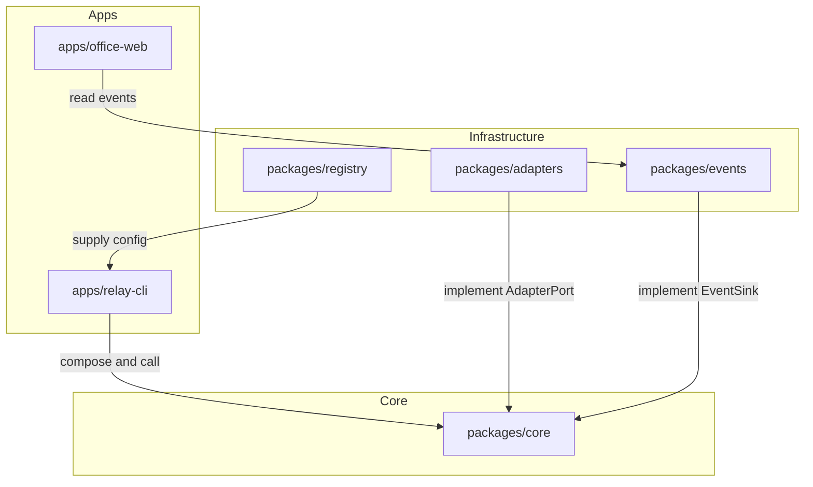

Chinese: [README.md](./README.md)

# grokbot-ai-office

grokbot-ai-office is a multi-AI collaborative office: any AI joins Grok Bot group chats the same way, and a live virtual-office UI shows what each AI is doing.

The project has two layers:

1. The relay layer is the foundation. `ai-relay`, the registry, adapters, and events connect any AI to the group chat and record what it is doing.
2. The virtual-office UI is the front. It reads those events and shows each AI.

Goals:

1. Add a new AI by editing configuration first, not core code.
2. Report failures with an error code. Never invent an answer.
3. Keep secrets out of the repository.
4. Keep the UI decoupled from relay logic.

## Three auth methods

| `auth` | Adapter | Where credentials live | Used for |
| --- | --- | --- | --- |
| `subscription` | CLI adapter | The CLI's own login files. The repo never stores them. | Codex, CodeBuddy, Hermes, OpenClaw |
| `api_key` | Official API adapter | Environment variables. Config only names `key_env`. | DeepSeek, Anthropic, Gemini, Kimi, GLM, MiniMax, OpenRouter |
| `openai_compatible` | OpenAI-format adapter | `base_url` plus optional `key_env` | Proxies, OpenRouter, local Ollama |

## Architecture



Apps wire dependencies. `packages/core` defines `AdapterPort` and `EventSink` and does not call a CLI or HTTP API itself. `apps/office-web` only reads `packages/events`.

## Layout

```
grokbot-ai-office/
├── AGENTS.md
├── README.md
├── README.en.md
├── CONTRIBUTING.md
├── CHANGELOG.md
├── .github/workflows/ci.yml
├── .gitignore
├── .env.example
├── package.json
├── pnpm-workspace.yaml
├── turbo.json
├── tsconfig.base.json
├── biome.json
├── .releaserc.json
├── packages/
│   ├── core/
│   ├── adapters/
│   ├── registry/
│   └── events/
├── apps/
│   ├── relay-cli/
│   └── office-web/
├── configs/providers.yaml
├── scripts/
├── docs/
└── tests/
```

## Quick start

Requires Node.js 22 and pnpm 9.

1. Install dependencies: `pnpm install`
2. Build: `pnpm build`
3. Check: `pnpm lint && pnpm typecheck && pnpm test`
4. Copy the env template: `cp .env.example .env`. Fill it only on your machine. Do not commit `.env`.

In this skeleton, adapters do not call a real AI. A known name returns an explicit not-implemented error. An unknown name returns `PROVIDER_NOT_FOUND`.

```bash
pnpm build
pnpm relay missing-bot "hello"
```

`pnpm selfcheck <name>` is reserved for real calls. The current script does not send a request, and CI does not run it.

## Onboard a new AI

1. Choose one of `subscription`, `api_key`, or `openai_compatible`.
2. Add a block to `configs/providers.yaml`.
3. For a subscription, log in with that CLI locally. For a key, put the variable in your local `.env`.
4. Run `pnpm selfcheck <name>`.
5. Create a relay bot and add it to the group chat.

Add adapter code only when none of the three methods can cover the provider.

## Security

- Secrets belong in `.env` or the process environment.
- `.env.example` lists variable names only. Values stay empty.
- `key_env` must be an `UPPER_SNAKE` variable name, not a secret.
- A string that looks like a secret (it starts with `sk-`) fails validation.
- Every `subscription` provider must set `safe_mode`.
- Events default to `~/.grokbot-ai-office/events.jsonl`. Override the path with `RELAY_EVENTS_PATH`. Events do not store the prompt or the answer.
- Agents on one machine share `RELAY_WORKSPACE`, which defaults to `~/.grokbot-ai-office/workspace`. That directory must not hold secrets, and `.gitignore` excludes `workspace/`.
- `RELAY_HOST` names the machine, for example `mac` or `cloud`. The external id is `provider@host`, such as `codex@mac`. The registry stays shared per AI name.
- Do not commit `.env`, CLI login files, event logs, or the workspace.

## Roadmap

1. **Skeleton**: repository layout, design docs, registry validation, and error codes. This stage.
2. **Relay core and adapters**: real CLI, official API, and OpenAI-compatible calls.
3. **Events and switching bots**: append JSONL events and switch AIs inside the group chat.
4. **Office UI**: `apps/office-web` reads events and shows each AI as a character.

## Docs

- Instructions for coding agents: [AGENTS.md](./AGENTS.md)
- Architecture: [docs/ARCHITECTURE.md](./docs/ARCHITECTURE.md)
- Engineering conventions: [docs/CONVENTIONS.md](./docs/CONVENTIONS.md)
- Contributing: [CONTRIBUTING.md](./CONTRIBUTING.md)
