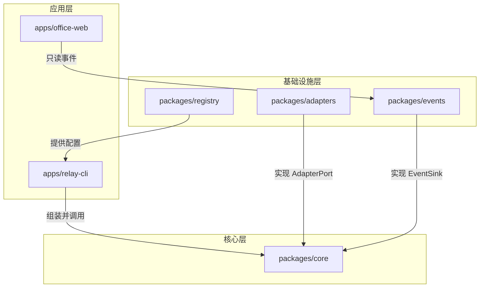

英文文档：[README.en.md](./README.en.md)

# grokbot-ai-office

grokbot-ai-office 是一个可复用的多 AI 中转层。命令 `ai-relay <名字> <提示>` 按照 `configs/providers.yaml` 调用对应的 AI，并把状态事件写到本机。以后的虚拟办公室页面只读这些事件，不直接调用 AI。

设计目标：

1. 接入一个新 AI，优先只改配置，不改核心代码。
2. 出错如实返回错误码，不编造回答。
3. 密钥不进仓库。
4. 界面与中转逻辑解耦。

## 三种接入方式

| `auth` | 适配器 | 凭证放在哪里 | 适用 |
| --- | --- | --- | --- |
| `subscription` | CLI 适配器 | 各 CLI 自己的登录文件，仓库不保存 | Codex、CodeBuddy、Hermes、OpenClaw |
| `api_key` | 官方 API 适配器 | 环境变量，配置里只写 `key_env` | DeepSeek、Anthropic、Gemini、Kimi、GLM、MiniMax、OpenRouter |
| `openai_compatible` | OpenAI 格式适配器 | `base_url` 加可选的 `key_env` | 中转站、OpenRouter、本地 Ollama |

## 架构



应用层只组装依赖。`packages/core` 定义 `AdapterPort` 和 `EventSink`，不直接调用 CLI 或 HTTP。`apps/office-web` 只读 `packages/events`。

## 目录

```
grokbot-ai-office/
├── AGENTS.md
├── README.md
├── README.en.md
├── CONTRIBUTING.md
├── CHANGELOG.md
├── .github/workflows/ci.yml
├── .gitignore
├── .env.example
├── package.json
├── pnpm-workspace.yaml
├── turbo.json
├── tsconfig.base.json
├── biome.json
├── .releaserc.json
├── packages/
│   ├── core/
│   ├── adapters/
│   ├── registry/
│   └── events/
├── apps/
│   ├── relay-cli/
│   └── office-web/
├── configs/providers.yaml
├── scripts/
├── docs/
└── tests/
```

## 快速开始

需要 Node.js 22 和 pnpm 9。

1. 安装依赖：`pnpm install`
2. 构建：`pnpm build`
3. 检查：`pnpm lint && pnpm typecheck && pnpm test`
4. 复制环境变量模板：`cp .env.example .env`，只在本机填写，不要提交 `.env`。

骨架阶段的适配器还不会请求真实 AI。已登记的名字会返回明确的未实现错误；未登记的名字会返回 `PROVIDER_NOT_FOUND`。

```bash
pnpm build
pnpm relay missing-bot "你好"
```

`pnpm selfcheck <名字>` 预留给真实调用。当前脚本不会发起请求，也不会进入 CI。

## 接入一个新 AI

1. 在 `subscription`、`api_key`、`openai_compatible` 三种方式里选一种。
2. 在 `configs/providers.yaml` 增加一段配置。
3. 订阅方式在本机登录对应 CLI；密钥方式把变量写入本机 `.env`。
4. 运行 `pnpm selfcheck <名字>`。
5. 创建中转 bot，并加入群聊。

只有这三种方式都覆盖不了时，才新增适配器代码。

## 安全

- 密钥只放在 `.env` 或系统环境变量中。
- `.env.example` 只有变量名，值为空。
- `key_env` 只能是全大写加下划线的变量名，不能写成密钥。
- 配置里出现以 `sk-` 开头的疑似密钥时，校验会直接失败。
- 每个 `subscription` 提供者都必须声明 `safe_mode`。
- 事件默认写到 `~/.grokbot-ai-office/events.jsonl`，可用 `RELAY_EVENTS_PATH` 改路径。事件不记录提示原文和回答原文。
- 同一台机器上的 agent 共用 `RELAY_WORKSPACE`，默认是 `~/.grokbot-ai-office/workspace`。该目录不得存放密钥，`.gitignore` 会排除 `workspace/`。
- `RELAY_HOST` 区分机器，例如 `mac` 和 `cloud`。对外标识是 `provider@host`，如 `codex@mac`。注册表仍按 AI 名字共享。
- 不要提交 `.env`、CLI 登录文件、事件日志或工作目录。

## 路线图

1. **骨架**：仓库结构、设计规范、注册表校验和错误码。当前阶段完成这一步。
2. **中转核心与适配器**：接通 CLI、官方 API、OpenAI 兼容三种调用。
3. **状态事件与切换 bot**：把事件写入 JSONL，并在群聊里切换不同的 AI。
4. **虚拟办公室界面**：`apps/office-web` 只读事件，把每个 AI 显示为一个角色。

## 文档

- 给 AI 编码助手的说明：[AGENTS.md](./AGENTS.md)
- 架构：[docs/ARCHITECTURE.md](./docs/ARCHITECTURE.md)
- 工程规范：[docs/CONVENTIONS.md](./docs/CONVENTIONS.md)
- 贡献：[CONTRIBUTING.md](./CONTRIBUTING.md)
