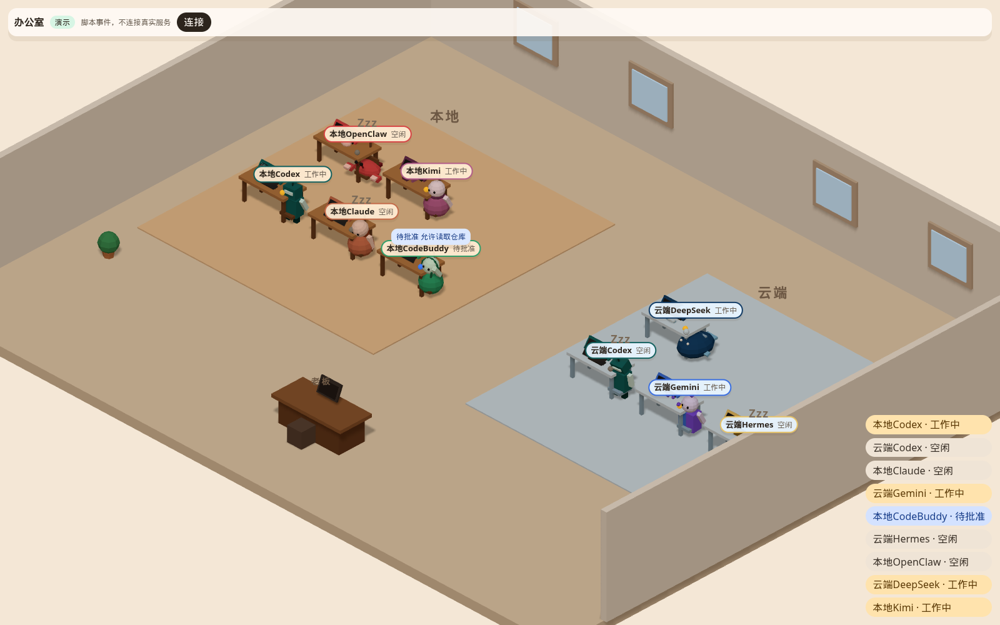

# 3D office

The office is a read-only front end. It does not call an AI and it does not read secrets. People and screens come from the `v: 1` events `ai-relay serve` already writes.

The default camera is an orthographic isometric view of one floor. The local zone (`mac`) is on the left. The cloud zone (`cloud`) is on the right. Each `provider@host` gets a desk, a monitor, and a character. Click a desk and the camera moves in on that screen. The boss desk in the foreground is a placeholder. The first-person view and the console are step 5.

## Run

Build first.

```bash
pnpm install
pnpm build
pnpm office
```

`pnpm office` is `ai-relay office`. The page binds to `127.0.0.1` only, port `8789` by default, and prints the URL. Change the port:

```bash
ai-relay office --port 8790
```

`RELAY_OFFICE_PORT` sets the same port. `RELAY_OFFICE_DIST` points at the built files. The default search path is `apps/office/dist`.

For Vite during development:

```bash
pnpm --filter @grokbot-ai-office/office dev
```

Open the printed URL with `?demo=1`, or type the event server address in the page.

## Demo mode

You can look at the office without a real AI:

```bash
pnpm office:demo
```

That is `ai-relay office --demo`. The URL includes `?demo=1`. The page plays a fixed script: Codex on both the local and cloud zones, plus Claude, Gemini, CodeBuddy, Hermes, OpenClaw, DeepSeek, and Kimi. GLM and WorkBuddy arrive later. The script includes working, idle, waiting for approval, stuck, and one handoff. Terminal color is ANSI, played in xterm.js.

Demo mode does not connect to port `8787` and does not read the local event log.

The overview below is demo mode. The warm wood desks are the local zone, and the cool desks are the cloud zone. Each provider has its own character.



## Connect to the event server

In another terminal:

```bash
pnpm serve
```

`ai-relay serve` defaults to `http://127.0.0.1:8787`. After the office opens, enter that address under Connect.

1. The page calls `GET /state` and replays each `terminalTail`.
2. It then opens WebSocket `/events` and appends later `output_chunk` events to that xterm.js screen.
3. `status` drives motion. Working types. Stuck turns on a red lamp and a reason bubble. Waiting for approval raises a hand and shows the summary. This page cannot approve or decline. Idle sleeps with Zzz. A handoff walks a file to the other desk and back.

If the socket drops, the page waits 0.5s, then 1s, then 2s, up to 15s, and the corner says it is reconnecting.

When `RELAY_SERVER_TOKEN` is set, type that same token in the page. It is stored in `sessionStorage` for this tab only. Do not put it in the repo, in chat, or in the office page query string. If the page URL contains `token`, the page deletes it and does not save it.

Browsers cannot set `Authorization` on a WebSocket. The token is therefore sent as a query parameter on the WebSocket to the event server. `ai-relay serve` already accepts that. The office address bar never includes the token. `GET /state` uses `Authorization: Bearer`.

The event server sends CORS headers on `GET /state`, so the page on port `8789` can read port `8787`. The preflight does not carry the token and returns no data.

## Names

`codex@mac` is labeled 本地Codex. `codex@cloud` is labeled 云端Codex. Edit `apps/office/public/names.json`, rebuild, or refresh the dev server.

```json
{
  "hosts": { "mac": "本地", "cloud": "云端" },
  "providers": { "codex": "Codex" },
  "instances": { "codex@mac": "Desk A" }
}
```

`instances` wins over `providers` and the host prefix.

## Looks

Each provider has a low-poly look: body, palette, accessory, desk prop, monitor bezel, name-tag color, idle pose, and typing motion. The meshes are original. There are no trademarks and no third-party textures.

| Provider | Look |
| --- | --- |
| `codex` | Dark-teal block robot with an antenna |
| `claude` | Warm terracotta round body with a scarf |
| `gemini` | Blue and purple halves, with small stars |
| `codebuddy`, `workbuddy` | Green, with a headset |
| `hermes` | Gold and white messenger, small wings, a satchel |
| `openclaw` | Red lobster with two claws |
| `deepseek` | Deep-blue whale |
| `kimi`, `glm`, and any other name | A soft palette hashed from the name, stable across reloads |

The same provider on `mac` and `cloud` is the same character. Local desks are warm wood with a lamp. Cloud desks are cool, with a halo and a bluer name tag. A status lamp sits on the desk corner, separate from the body color, so a red lobster still shows a red lamp when stuck.

Two ways to override a look. Later entries win.

1. Edit `apps/office/public/office-styles.json`. Camel case and snake case both work. Unknown fields are ignored.
2. Add an optional `office:` block in `configs/providers.yaml`. Only `ai-relay office` reads it, and it overrides the JSON. If the registry fails validation, the page still opens and uses the default looks.

```yaml
codex:
  auth: subscription
  command: ["codex", "exec", "--sandbox", "read-only", "--skip-git-repo-check", "-"]
  safe_mode: "--sandbox read-only"
  office:
    body: robot
    accessory: antenna
    desk_prop: keyboard
    bezel: "#14615f"
    name_tag: "#14615f"
    idle_pose: hover
    typing: keys
    palette:
      primary: "#14615f"
      secondary: "#d7f4f1"
      accent: "#083633"
```

`body` is one of `robot`, `round`, `twin`, `headset`, `messenger`, `lobster`, `whale`, `blob`. Colors are `#RRGGBB`.

To change one instance, use `instances` in the JSON, for example `"codex@cloud"`. The host accent on the desk is not overridden, so local and cloud stay distinct.

Procedural characters are the default. A later `.glb` can be dropped in `apps/office/public/models/` and is picked up on refresh, without scene code changes. A missing file keeps the procedural character.

| File | Used for |
| --- | --- |
| `codex.glb`, `claude.glb`, `gemini.glb`, `hermes.glb`, `openclaw.glb`, `deepseek.glb` | That provider |
| `workbuddy.glb` | `workbuddy` and `codebuddy` |
| `generic.glb` | Every other name. Material `MAT_Primary` is recolored with the hash palette primary |
| `desk_local.glb` | The local zone, and any other host |
| `desk_cloud.glb` | The cloud zone |

An avatar can expose child nodes `Body`, `Head`, `ArmL`, `ArmR`, `LegL`, `LegR`, with rest rotation at 0. The office tweens those nodes. Or it can use an armature with those bone names plus clips `Idle`, `Typing`, `Sleep`, `RaiseHand`, `Walk`, and `Stuck`. When those clips exist they play through `AnimationMixer`. Otherwise the named nodes are tweened.

A desk includes a mesh named `Screen`. Its origin is the center of the glass, it faces local +Z, width runs along X, and height along Y. The terminal sits on that face and scales to its width and height. A desk model without `Screen` falls back to the procedural desk. Loaded models are scaled to the same size as the procedural desk and character.

## Performance and accessibility

The target is about 60fps on a MacBook with about 10 characters. The shadow map is 1024. The pixel ratio is capped at 1.5. At most four xterm.js instances run at once. On-screen monitors come first, and the focused one is always included. Terminals that leave the view are disposed. When they return, `terminalTail` is replayed.

With “reduce motion” enabled, walking and typing do not loop, and the camera cuts. The lamp, the raised hand, Zzz, and the text stay.

The roster buttons focus a desk. Escape returns to the overview.

## Security

- The page does not read `.env`. The token is not written into the repo or the address bar.
- The static server binds to `127.0.0.1` only.
- A token in the office page query string is stripped.
- Do not put secrets in `office-styles.json` or `office:`. A string that looks like a secret fails registry validation.
- Approve and decline buttons, and the boss console, are step 5. Bubbles in this step only show the summary.
