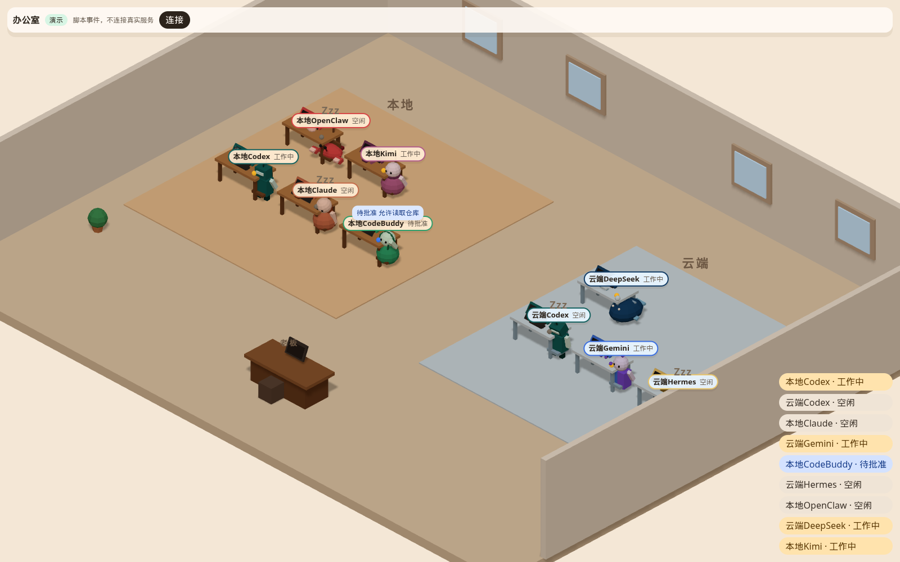

# 3D 办公室

办公室是只读的前端。它不调用 AI，也不读密钥。画面上的人和屏幕都来自 `ai-relay serve` 已经写好的 `v: 1` 事件。

默认是正交等距的一层楼。左边是本地区（`mac`），右边是云端区（`cloud`）。每个 `provider@host` 有一张桌子、一台显示器和一个角色。点桌子，镜头拉近到那块屏幕。老板桌在前景，只是占位，第一人称和控台留到第 5 步。

## 运行

需要先构建。

```bash
pnpm install
pnpm build
pnpm office
```

`pnpm office` 就是 `ai-relay office`。页面只监听 `127.0.0.1`，默认端口 `8789`，启动后打印地址。换端口：

```bash
ai-relay office --port 8790
```

也可以设 `RELAY_OFFICE_PORT`。`RELAY_OFFICE_DIST` 指向构建目录，默认会找 `apps/office/dist`。

开发时可以直接起 Vite：

```bash
pnpm --filter @grokbot-ai-office/office dev
```

然后打开它打印的地址，并加上 `?demo=1`，或者在页面里填写事件服务地址。

## 演示模式

没有真实 AI 时也能看：

```bash
pnpm office:demo
```

等价于 `ai-relay office --demo`，地址带 `?demo=1`。页面播放一段写好的事件：本地和云端各有一个 Codex，另外还有 Claude、Gemini、CodeBuddy、Hermes、OpenClaw、DeepSeek、Kimi，随后 GLM 和 WorkBuddy 进场。里面有工作、空闲、待批准、卡住和一次交接。终端里的颜色是 ANSI，不是贴上去的图片。

演示不连接 `8787`，也不读本机事件日志。

下图是演示总览。左边暖木色是本地区，右边冷色是云端区。不同提供者的角色不一样。



## 连接事件服务

另开一个终端：

```bash
pnpm serve
```

`ai-relay serve` 默认是 `http://127.0.0.1:8787`。办公室页面打开后，在「连接」里填写这个地址。

1. 页面先 `GET /state`，用返回的 `terminalTail` 重放每个屏幕。
2. 再连 WebSocket `/events`，把之后的 `output_chunk` 追加到对应的 xterm.js。
3. `status` 驱动动作：工作是打字，卡住是红灯和原因气泡，等待批准是举手和摘要（这里不能批准或拒绝），空闲是睡觉和 Zzz，交接是抱着文件走到对方桌边再回来。

连不上时会按 0.5 秒、1 秒、2 秒往上退，最长 15 秒，并在角上写明「正在重连」。

如果设了 `RELAY_SERVER_TOKEN`，在页面里填写同一串令牌。令牌放在 `sessionStorage`，只在这个标签页里有效。不要把它放进仓库、聊天，或办公室页面的查询字符串。页面如果发现地址里有 `token`，会删掉它，并且不会保存。

浏览器的 WebSocket 不能加 `Authorization` 头。因此连到事件服务时，令牌会放在 WebSocket 的查询参数里。这是现有 `ai-relay serve` 已经接受的方式。办公室自己的地址栏里没有令牌。`GET /state` 使用 `Authorization: Bearer`。

事件服务对 `GET /state` 加了跨域响应头，这样 `8789` 上的页面可以读 `8787`。预检请求不带令牌，也读不到数据。

## 名字

默认 `codex@mac` 显示为「本地Codex」，`codex@cloud` 显示为「云端Codex」。要改称呼，编辑 `apps/office/public/names.json`，然后重新构建，或在开发服务器里刷新。

```json
{
  "hosts": { "mac": "本地", "cloud": "云端" },
  "providers": { "codex": "Codex" },
  "instances": { "codex@mac": "工位甲" }
}
```

`instances` 优先于 `providers` 和主机前缀。

## 形象

每个提供者有一套低多边形形象：身体、配色、配件、桌上道具、显示器边框、名牌颜色、空闲姿势和打字动作。这些都是原创几何体，没有商标或现成贴图。

| 提供者 | 形象 |
| --- | --- |
| `codex` | 深青色方块机器人，头顶天线 |
| `claude` | 暖陶土色的圆身体，围着围巾 |
| `gemini` | 蓝紫对半，旁边有小星星 |
| `codebuddy`、`workbuddy` | 绿色，戴耳机 |
| `hermes` | 金白信使，脚边有小翅膀，带着包 |
| `openclaw` | 红色小龙虾，两只钳子 |
| `deepseek` | 深蓝色鲸 |
| `kimi`、`glm` 以及其他名字 | 由名字哈希出来的圆润配色，每次都一样 |

同一个人在 `mac` 和 `cloud` 上是同一个角色。本地区的桌子是暖木色，有一盏台灯。云端区的桌子是冷色，头顶有一圈光环，名牌也偏蓝。状态灯在桌子角上，不靠身体颜色表达，所以红色的小龙虾卡住时仍然能看出红灯。

改形象有两种办法，后面的盖住前面的。

1. 编辑 `apps/office/public/office-styles.json`。字段用驼峰或下划线都可以。无法识别的字段会被忽略。
2. 在 `configs/providers.yaml` 里给提供者加可选的 `office:`。只有 `ai-relay office` 会读它，并且盖过 JSON。注册表校验不通过时，页面仍会打开，并改用默认形象。

```yaml
codex:
  auth: subscription
  command: ["codex", "exec", "--sandbox", "read-only", "--skip-git-repo-check", "-"]
  safe_mode: "--sandbox read-only"
  office:
    body: robot
    accessory: antenna
    desk_prop: keyboard
    bezel: "#14615f"
    name_tag: "#14615f"
    idle_pose: hover
    typing: keys
    palette:
      primary: "#14615f"
      secondary: "#d7f4f1"
      accent: "#083633"
```

`body` 可以是 `robot`、`round`、`twin`、`headset`、`messenger`、`lobster`、`whale`、`blob`。颜色必须是 `#RRGGBB`。

某个具体实例要单独改，写在 JSON 的 `instances` 里，例如 `"codex@cloud"`。主机带来的桌子颜色不能在这里改掉，这样本地和云端始终分得开。

程序形象是默认。以后可以把 `.glb` 放进 `apps/office/public/models/`，刷新页面就会换上，不用改场景代码。文件不存在时仍用程序形象。

| 文件 | 谁用 |
| --- | --- |
| `codex.glb` `claude.glb` `gemini.glb` `hermes.glb` `openclaw.glb` `deepseek.glb` | 同名提供者 |
| `workbuddy.glb` | `workbuddy` 和 `codebuddy` |
| `generic.glb` | 其他名字。材质 `MAT_Primary` 会按名字哈希的主色重新着色 |
| `desk_local.glb` | 本地区，以及其他主机 |
| `desk_cloud.glb` | 云端区 |

角色二选一。可以有子节点 `Body`、`Head`、`ArmL`、`ArmR`、`LegL`、`LegR`，休息姿势的旋转是 0，办公室在这些节点上做动作。也可以是同名骨骼，并带片段 `Idle`、`Typing`、`Sleep`、`RaiseHand`、`Walk`、`Stuck`。有这些片段就用 `AnimationMixer` 播放，没有就退回节点动作。

桌子里要有名为 `Screen` 的网格。它的原点在屏幕中心，面朝局部 +Z，宽沿 X，高沿 Y。终端贴在这个面的前面，并按它的宽高缩放。没有 `Screen` 时，这张桌子退回程序桌子。模型会缩放到和现有桌子、角色相近的尺寸。

## 性能和辅助功能

画面目标是在一台 MacBook 上、大约 10 个角色时保持 60 帧。阴影贴图是 1024，像素比不超过 1.5。同时最多 4 个 xterm.js。镜头里的屏幕优先，点中的那台一定在里面。离开画面的终端会卸掉，回到画面时用 `terminalTail` 再放一遍。

系统打开「减少动态效果」后，走路和打字不再循环，镜头直接切过去。状态灯、举手、Zzz 和文字还在。

名册里的按钮可以点到对应的桌子。按 Esc 回到总览。

## 安全

- 页面不读取 `.env`，也不把令牌写进仓库或地址栏。
- 静态服务只绑 `127.0.0.1`。
- 令牌若出现在办公室网址的查询参数里，会被删掉。
- 不要把密钥打进 `office-styles.json` 或 `office:`。注册表里出现疑似密钥时，整个配置会校验失败。
- 第 5 步才会做批准按钮和老板控台。这一步的气泡只展示摘要。

## 当前放入的模型（第 5 版）

`apps/office/public/models/` 里现在放的是第 5 版设计稿导出的模型，来源是 `grokbot-office-redesign/out/characters/` 和 `out/kit/`。

- 8 个角色：`codex`、`claude`、`gemini`、`workbuddy`、`hermes`、`openclaw`、`deepseek`、`generic`。节点有 `Body`、`Head`、`ArmL`、`ArmR`、`LegL`、`LegR`，没有动画片段，所以走节点动作。手和腿是空节点，身体是一整块 `Shell`，因此看得到的动作主要是身体和头。模型带 9 个表情形态键（`neutral`、`happy`、`surprised`、`sad`、`sleepy`、`squinted`、`calm`、`inspecting`、`confused`），办公室暂时还没用。`generic.glb` 用 `MAT_Primary` 按名字着色。
- 2 张桌子：`desk_local`、`desk_cloud`。原稿里 `Screen` 的顶点是按整张桌子的原点烘焙的，放进来之前把它的原点挪到了屏幕中心（`0.30, 1.24, -0.15`），朝 +Z，宽 0.92、高 0.48，其他不变。
- 椅子、台灯、地板、墙等 57 个环境模型没有放进来。办公室的场景代码只认角色和桌子两类文件，接它们要另改场景。
